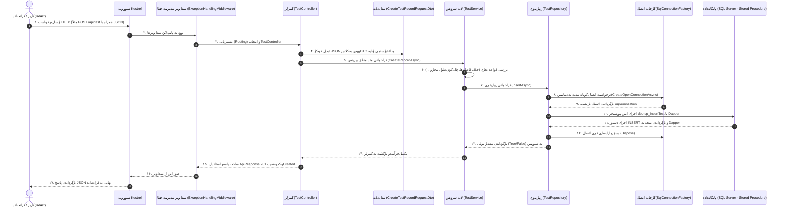

# نقشه راه و چرخه حیات درخواست در بک‌اند دات‌نت کور (ASP.NET Core 10)
## راهنمای گام‌به‌گام و مصور از فرانت‌اند تا استورد پروسیجر و بازگشت پاسخ

> **هدف این سند:**  
> اگر با دات‌نت کور (ASP.NET Core) و معماری تمیز (Clean Architecture) آشنایی قبلی ندارید، این راهنما به زبان ساده، دقیق و با ترتیب ثانیه‌به‌ثانیه به شما نشان می‌دهد وقتی کاربر در فرانت‌اند دکمه‌ای را می‌زند یا درخواستی ارسال می‌کند، این درخواست در بک‌اند وارد چه فایل‌هایی می‌شود، چه کدهایی اجرا می‌شوند و چگونه داده‌ها از دیتابیس خوانده شده یا در آن ذخیره می‌شوند.

---

## ۱. تصویر کلی چرخه حیات (Lifecycle Infographic)

یک فایل تصویری اینفوگرافیک با کیفیت بالا در مسیر اصلی پروژه ذخیره شده است:  
`Backend_Request_Flow.jpg`

---

## ۲. نمودار توالی گام‌به‌گام (Sequence Diagram)

نمودار زیر دقیقاً مسیر رفت و برگشت یک درخواست (مثلاً ثبت رکورد با `POST /api/test`) را نشان می‌دهد:



---

## ۳. بررسی مرحله‌به‌مرحله و کدهای هر بخش (ترتیب ورود درخواست)

### گام اول: فرانت‌اند (Frontend Client)
کاربر در صفحه کاربری مثلاً نام «Ali» و سن «30» را وارد کرده و دکمه ذخیره را می‌زند:
```javascript
// درخواست فرانت‌اند به سمت بک‌اند
fetch('http://localhost:5226/api/test', {
    method: 'POST',
    headers: { 'Content-Type': 'application/json' },
    body: JSON.stringify({ name: "Ali", age: "30" })
});
```

---

### گام دوم: ورود به سرور وب (Kestrel) و میدل‌ویرها (Middlewares)
- **اولین ایستگاه در بک‌اند:** سرور وب Kestrel درخواست شبکه را دریافت می‌کند.
- **فایل:** `Program.cs`
- درخواست وارد پایپ‌لاین میدل‌ویرها می‌شود:
  1. ابتدا وارد `ExceptionHandlingMiddleware` می‌شود (که مانند یک چتر نجات، کل درخواست را در `try...catch` می‌پوشاند تا اگر در هر مرحله‌ای خطایی رخ داد، سیستم کرش نکند و رمزها یا ساختار دیتابیس به کلاینت لو نرود).
  2. سپس سیستم Routing دات‌نت مسیر `/api/test` و متد `POST` را بررسی کرده و می‌فهمد باید کدام کنترلر را بیدار کند.

---

### گام سوم: ورود به کنترلر (API Controller)
- **پروژه:** `ChemicalDashboard.Api`
- **فایل و کلاس:** `Controllers/TestController.cs`
- **وظیفه کنترلر:** کنترلر **هیچ کار دیتابیسی انجام نمی‌دهد**. کنترلر فقط یک مسئول پذیرش هتل است؛ درخواست را تحویل می‌گیرد، چک می‌کند ورودی‌ها معتبر باشند و کار را به لایه سرویس می‌سپارد.
- **کلاس DTO:** فریم‌ورک دات‌نت متن JSON فرانت‌اند را خودکار به شیء کلاسی به نام `CreateTestRecordRequestDto` (در پروژه Contracts) تبدیل می‌کند.
- **کد کنترلر:**
```csharp
[HttpPost]
public async Task<ActionResult<ApiResponse<bool>>> Create(
    [FromBody] CreateTestRecordRequestDto request,
    CancellationToken cancellationToken)
{
    // ۱. بررسی اعتبار اولیه فیلدها
    if (!ModelState.IsValid) return BadRequest(...);

    // ۲. سپردن کار اصلی به لایه سرویس
    var result = await _testService.CreateRecordAsync(request, cancellationToken);

    // ۳. بازگرداندن پاسخ HTTP 201 Created
    return StatusCode(201, ApiResponse<bool>.Ok(result, "با موفقیت ثبت شد"));
}
```

---

### گام چهارم: ورود به لایه منطق تجاری (Application Service)
- **پروژه:** `ChemicalDashboard.Application`
- **فایل و کلاس:** `Services/TestService.cs`
- **چرا این لایه وجود دارد؟**  
  چون قواعد کسب‌وکار نباید در کنترلر باشند و نباید در دیتابیس پراکنده شوند. مثلاً اگر بگوییم:
  - «نام نباید خالی باشد»،
  - «نام نباید بیشتر از ۱۰ کاراکتر باشد»،
  - «فاصله‌های اول و آخر نام باید حذف (Trim) شوند»،  
  همه این قوانین در این لایه بررسی می‌شوند.
- همچنین این لایه هیچ نامی از SQL Server یا Dapper نمی‌شناسد، بلکه فقط از طریق اینترفیس `ITestRepository` با لایه پایینی صحبت می‌کند (اصل Dependency Inversion).
- **کد سرویس:**
```csharp
public async Task<bool> CreateRecordAsync(CreateTestRecordRequestDto request, CancellationToken cancellationToken)
{
    var trimmedName = request.Name?.Trim();
    var trimmedAge = request.Age?.Trim();

    // بررسی قوانین بیزینس
    if (trimmedName.Length > 10) 
        throw new ArgumentException("طول نام نمی‌تواند بیش از ۱۰ کاراکتر باشد.");

    // ارسال به ریپازیتوری جهت ثبت در دیتابیس
    return await _repository.InsertAsync(trimmedName, trimmedAge, cancellationToken);
}
```

---

### گام پنجم: ورود به لایه زیرساخت و ریپازیتوری (Infrastructure Repository & Dapper)
- **پروژه:** `ChemicalDashboard.Infrastructure`
- **فایل و کلاس:** `Repositories/TestRepository.cs`
- **وظیفه این لایه:** تنها لایه‌ای که اجازه دارد با دیتابیس و کابل شبکه SQL Server صحبت کند.
- در این لایه:
  1. ابتدا از `IDbConnectionFactory` یک اتصال باز تقاضا می‌شود.
  2. کلاس `SqlConnectionFactory` رشته اتصال امن را از `appsettings.json` می‌خواند و اتصال `SqlConnection` را باز می‌کند.
  3. پارامترها با کتابخانه **Dapper** به شکل کاملاً ایمن (جلوگیری از SQL Injection) آماده می‌شوند.
  4. استورد پروسیجر به شکل صریح با دستور `CommandType.StoredProcedure` اجرا می‌شود.
- **کد ریپازیتوری:**
```csharp
public async Task<bool> InsertAsync(string name, string age, CancellationToken cancellationToken)
{
    // ۱. دریافت اتصال کوتاه‌مدت (با خروج از متد خودکار بسته می‌شود)
    await using var connection = await _connectionFactory.CreateOpenConnectionAsync(cancellationToken);

    // ۲. تعریف پارامترهای پروسیجر
    var parameters = new DynamicParameters();
    parameters.Add("@Name", name, DbType.StringFixedLength, size: 10);
    parameters.Add("@Age", age, DbType.String, size: 50);

    // ۳. اجرای پروسیجر با Dapper
    var command = new CommandDefinition(
        commandText: "dbo.sp_InsertTest",
        parameters: parameters,
        commandType: CommandType.StoredProcedure,
        cancellationToken: cancellationToken
    );

    await connection.ExecuteAsync(command);
    return true;
}
```

---

### گام ششم: پایگاه داده (SQL Server & Stored Procedure)
- **دیتابیس:** `HalalSazan` روی سرور `DESKTOP-3JJDKDN\SQL2022`
- پروسیجر `dbo.sp_InsertTest` در هسته دیتابیس صدا زده می‌شود:
```sql
CREATE PROCEDURE dbo.sp_InsertTest
    @Name NCHAR(10),
    @Age NVARCHAR(50)
AS
BEGIN
    SET NOCOUNT ON;
    INSERT INTO dbo.test (Name, Age) VALUES (@Name, @Age);
END
```
- رکورد در جدول درج می‌شود.

---

### گام هفتم: مسیر بازگشت (Response Flow)
پس از اجرای پروسیجر، همان مسیر به صورت معکوس طی می‌شود:
1. دیتابیس به Dapper پاسخ موفقیت می‌دهد.
2. با دستور `await using`، اتصال دیتابیس **فوراً بسته و به Connection Pool برگردانده می‌شود** (هیچ کانکشنی باز نمی‌ماند).
3. ریپازیتوری مقدار `true` را به سرویس بازمی‌گرداند.
4. سرویس نتیجه را به کنترلر تحویل می‌دهد.
5. کنترلر شیء استانداردی به نام `ApiResponse<bool>` می‌سازد:
```json
{
  "success": true,
  "message": "رکورد آزمایشی با موفقیت در پایگاه داده ثبت شد.",
  "data": true,
  "timestampUtc": "2026-10-09T08:15:58Z"
}
```
6. کنترلر این JSON را همراه با کد وضعیت HTTP (مثلاً `201 Created` یا `200 OK`) از طریق سرور Kestrel برای فرانت‌اند می‌فرستد.
7. فرانت‌اند پیام سبز موفقیت را به کاربر نمایش می‌دهد.

---

## ۴. مقایسه مفهوم لایه‌ها برای برنامه‌نویسان تازه به دات‌نت

| نام لایه | معادل در دنیای واقعی | وظیفه اصلی | کاری که نباید انجام دهد |
|---|---|---|---|
| **Contracts** | برگه فرم استخدام | تعریف ساختار داده‌های ورودی و خروجی (DTOها) | نباید هیچ کد محاسباتی یا دیتابیسی داشته باشد |
| **Api (Controllers)** | منشی / پذیرش شرکت | دریافت درخواست HTTP، اعتبارسنجی اولیه فرمت داده و تحویل به مسئول مربوطه | نباید مستقیم کوئری SQL بزند یا دیتابیس را صدا کند |
| **Application (Services)** | مدیر عملیات و کارشناس | اعتبارسنجی منطق کارخانه، محاسبات و تصمیم‌گیری | نباید به دستورات SQL یا پکیج‌های خاص پایگاه داده آلوده شود |
| **Infrastructure (Repositories)** | انباردار و مامور بایگانی | اجرای پروسیجر، باز کردن اتصال دیتابیس با Dapper و واکشی داده | نباید منطق بیزینس و محاسبات بیرونی را در خود نگه دارد |
| **SQL Server (Procedures)** | گاوصندوق اصلی و بایگانی اسناد | ذخیره دائم داده‌ها و اجرای تراکنش‌های پایگاه داده | - |

---

## ۵. اگر خطایی رخ دهد چه می‌شود؟ (Error Handling Flow)

فرض کنید کاربر ورودی نامعتبر بفرستد یا دیتابیس قطع باشد:
1. در هر نقطه‌ای (مثلاً ریپازیتوری یا سرویس) یک `Exception` پرتاب می‌شود.
2. این استثناء از کنترلر بالا می‌آید و به میدل‌ویر `ExceptionHandlingMiddleware` می‌رسد.
3. این میدل‌ویر خطا را متوقف می‌کند:
   - در لاگ داخلی سرور خطای کامل را با جزئیات می‌نویسد (تا برنامه‌نویس بررسی کند).
   - اما به فرانت‌اند یک پیام امن، زیبا و مرتب با کد `400` یا `500` بدون کدهای ترسناک SQL پس می‌دهد:
   ```json
   {
     "success": false,
     "message": "یک خطای پیش‌بینی نشده در سمت سرور رخ داد. لطفاً با مدیر سیستم تماس بگیرید.",
     "data": null
   }
   ```
این یعنی سیستم شما صنعتی، پایدار و ضد خطا (Fault-Tolerant) است.
